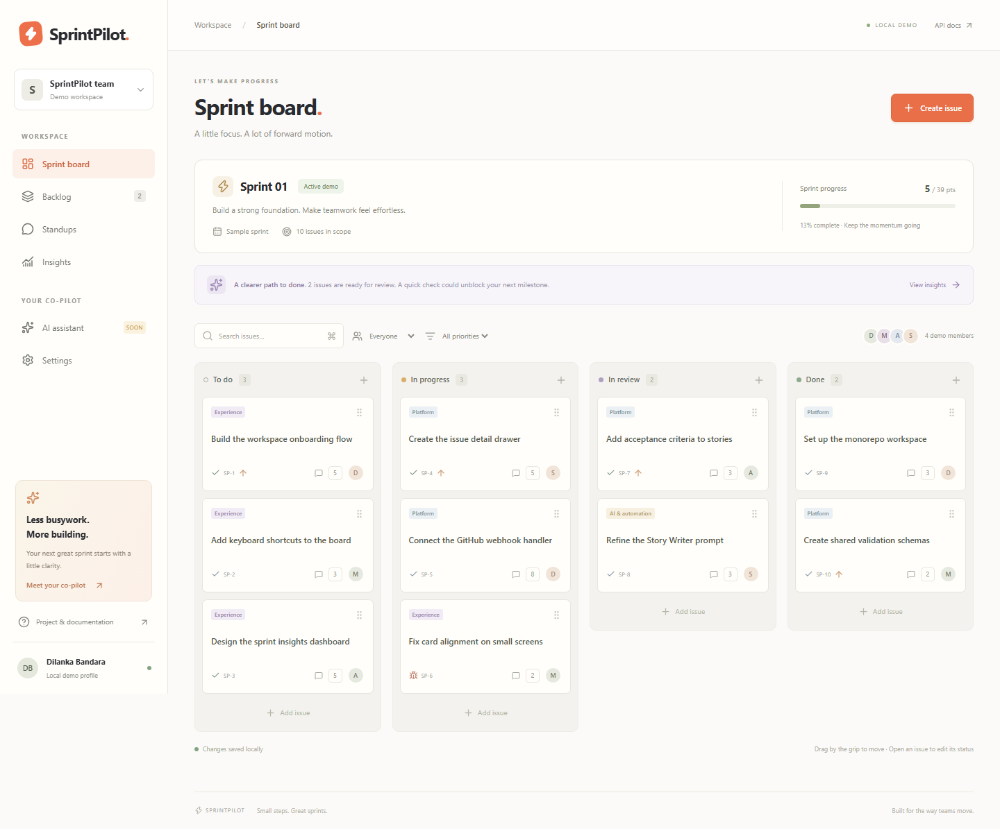
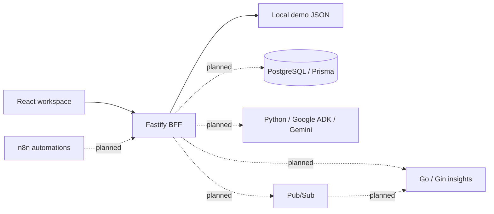

# SprintPilot

**A calmer way to plan, build, and ship together.** An Agile project manager with a working local demo and a roadmap toward a Gemini-powered Scrum assistant.



## What works today

- Responsive React workspace: sprint board, backlog, standups, insights, settings.
- Create, edit, delete, search, filter, and assign issues with story points and priorities.
- Drag issues across the board, or change status in the keyboard-accessible issue dialog.
- Fastify API with validated requests, Swagger, rate limits, consistent errors, and durable local demo storage.
- One daily standup per demo user, using the Asia/Colombo calendar date.
- Insights calculated from actual demo issues; no fabricated historical metrics.
- Go/Gin and Python/FastAPI service health endpoints; Google ADK dependency installed for the next AI milestone.
- Unit/API tests, Playwright desktop/mobile journeys, and three CI jobs.

**This is milestone 1, not the finished six-sprint product.** The demo has one local profile and a sample sprint. It does not provide Firebase authentication, PostgreSQL persistence, real multi-user workspaces, sprint lifecycle management, AI responses, GitHub webhooks, Pub/Sub, n8n automations, or cloud deployment yet. The API binds to `127.0.0.1` and refuses production mode. Do not expose it through a public tunnel or use it for sensitive information.

## Run the working demo

Install Node.js 22.20+ and pnpm 11.19.0, then:

```sh
pnpm install
pnpm dev
```

Open **http://127.0.0.1:5173**. API docs: **http://127.0.0.1:4000/docs**.

No credentials or Docker required for the demo. Demo issues seed automatically. Changes persist in `.data/demo.json` and are excluded from Git. Stop the API before deleting that file to reset the demo. Do not run multiple API processes against the same data file.

Try it:

1. Click **Create issue**, enter a title, and save.
2. Drag the new card by its grip to **Done**. Refresh to check persistence.
3. Open **Backlog**, search for the title, and open it to edit or delete.
4. Open **Standups**, post an update, then update it again: it remains one entry.
5. Open **Insights** to see current counts. The AI page explains what is still planned.

## Run all four service foundations

Also install Go 1.27+, Python 3.12, and uv. GNU Make is optional on Windows; equivalent commands are provided.

```sh
make setup    # pnpm run setup
make dev      # pnpm dev:all
```

Web: 5173 · API: 4000 · Insights: 8081 · Agents: 8000.
Each backend exposes `/health`. Web `/health` proxies the API health check. Only web/API and Python currently hot reload; rerun Go after edits.

```sh
curl http://127.0.0.1:4000/health
curl http://127.0.0.1:8081/health
curl http://127.0.0.1:8000/health
```

The health checks are liveness checks. Go metrics and AI agent execution explicitly report disabled, and no database readiness is implied.

## Verify

```sh
pnpm lint
pnpm test
pnpm build
pnpm exec playwright install chromium
pnpm e2e
go -C services/insights test ./...
go -C services/insights vet ./...
uv run --project services/agents ruff check services/agents
uv run --project services/agents ruff format --check services/agents
uv run --project services/agents pytest services/agents/tests
```

`make lint` and `make test` combine the language checks. CI additionally runs Go's race detector. E2E tests use isolated ports (5183/4100) and a fresh `.data/e2e-<timestamp>.json` file for each run, preserving your demo data.

## Optional local infrastructure

Copy `.env.example` to `.env`, change the local PostgreSQL password, and run `make infra` (`docker compose up -d`). This milestone provides PostgreSQL 16 and Mailpit only. They are preparation for later features and are not used by the demo API. PostgreSQL is on port 5432; Mailpit inbox is http://127.0.0.1:8025. Stop with `docker compose down` (database volume retained).

`make up`, `make migrate`, `make seed`, `make sqlc`, and `make eval` fail with an explanatory message until their real implementations land. They are not success-returning placeholders.

## Architecture



The browser calls only the BFF. The current demo module is explicitly separate from the planned authenticated workspace API; its local storage is not a replacement for the specified Prisma architecture.

See [architecture](docs/architecture.md), [stack choices](docs/TECH_STACK.md), [roadmap](docs/ROADMAP.md), and the [original project brief](docs/project-brief.md). The supplied document is preserved as a reference; its embedded example prompts are not automatically executed instructions or claims of completed work. Learning reflections remain for the human to write.

## How we work

Small, testable increments, Conventional Commits, feature branches, and reviewed pull requests. Run `pnpm exec lefthook install` to enable commit checks. Use the user-story and PR templates in `.github`. The [first milestone review](docs/sprints/sprint-1-review.md) records delivered work and limitations. A GitHub Project board and cloud resources have not been provisioned.
